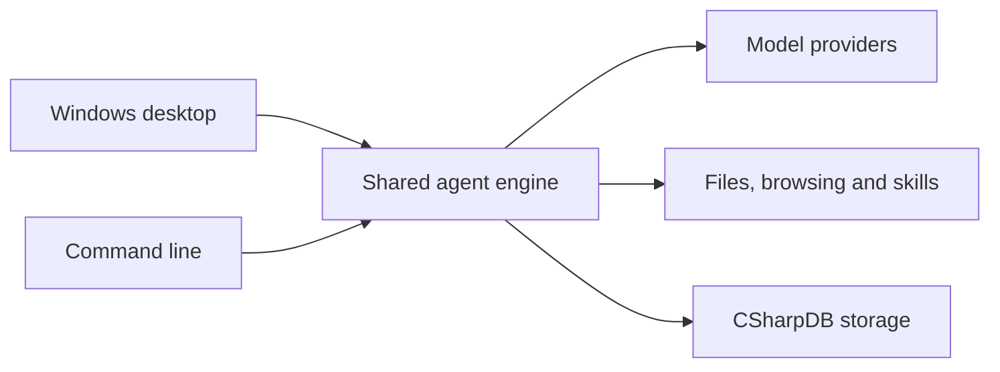

# IronPaw

IronPaw is a .NET 10 framework for building AI assistants that work with files, browse websites and delegate tasks to specialist agents. Use it through the Windows desktop app, from a terminal, or as a library in your own C# application.

You choose the model and the tools it can use. IronPaw coordinates the work, shows what is happening and saves a record you can return to later.

[Download for Windows](https://github.com/MaxAkbar/IronPaw/releases/latest) · [Run from source](#run-from-source) · [Documentation](#documentation)

## What you can do

- **Work with files.** Read, create and update files in a chosen working folder.
- **Share work between agents.** Delegate focused tasks to coding, review and web-browsing specialists.
- **Coordinate larger jobs.** Define tasks that depend on one another, share execution limits and verify file changes before accepting them.
- **Follow the progress.** See tool activity, task status and saved run history in the CLI or desktop app.
- **Continue saved work.** Pause and resume workflows, and inspect interrupted work before recovering it.
- **Add your own tools.** Write C# skills or connect external tools through Model Context Protocol (MCP).

## Try the Windows app

1. Open the [latest release](https://github.com/MaxAkbar/IronPaw/releases/latest) and download **IronPaw-win-x64.zip**.
2. Extract the whole ZIP, keeping its folders together.
3. Open **Start-IronPaw.cmd** and choose the folder IronPaw can work in.

The download includes the desktop app, CLI, .NET runtimes and Chromium browser runtime. Git and the pinned .NET SDK are still needed for repository task graphs and build/test verification. See [installation, updates and package verification](docs/releases.md).

### A first run without an API key

Select the `local` provider and try:

```text
Create a project plan and write it to Plan.md.
```

IronPaw will write a sample plan in your working folder and show the tool call and result. The built-in `local` provider is a scripted demo for trying the workflow without contacting an AI service. Choose one of the model providers below for open-ended tasks.

To try the same demo from PowerShell, open a terminal in the extracted folder and run:

```powershell
.\cli\IronPaw.Cli.exe --provider local --prompt "Create a project plan and write it to Plan.md"
```

The CLI uses the terminal's current folder as its working folder.

## Connect an AI model

A provider is the service or local application that runs your model. Both apps support these choices:

| Provider | What you need |
| --- | --- |
| `openai` | An OpenAI API key and a model available to your account |
| `anthropic` | An Anthropic API key and a model available to your account |
| `ollama` | A running Ollama server with a model installed |
| `lmstudio` | A running LM Studio server with a model loaded |
| `local` | Nothing to configure; runs the built-in scripted demo |

Choose the provider and model in the desktop app, or use `--provider` and `--model` in the CLI. Tool support depends on the model you select. The [provider setup guide](docs/tutorials/using-providers.md) covers credentials and local server settings.

## Settings, saved work and tool access

CLI and Desktop share settings at `%LOCALAPPDATA%\IronPaw\settings.json`. You can select another file with `IRONPAW_CONFIG`; the CLI also accepts `--config`. See [configuration](docs/runtime-configuration.md) for the available settings.

Sessions, transcripts, memories, run history and agent messages are stored locally in CSharpDB at `%LOCALAPPDATA%\IronPaw\state\application.cdb`. Workflow recovery records are kept separately under the same state folder.

When upgrading from JSON storage, close older IronPaw instances before the first run. IronPaw imports the JSON data once and preserves the original files. Legacy SQLite data is not imported. See [storage and migration](docs/application-storage.md).

Tool access is configured separately from your model. JavaScript browsing and MCP connectors need an explicit reviewed configuration. C# skills, connector processes and verification commands run with your operating-system permissions. See [browser controls](docs/browser-runtime.md) and [MCP connector setup](docs/mcp-connectors.md) before enabling them.

## Documentation

| I want to… | Read this |
| --- | --- |
| Walk through a first run | [Getting started](docs/getting-started.md) |
| Chat in the terminal and manage sessions | [Interactive mode](docs/tutorials/interactive-mode.md) |
| Set up a model provider | [Using providers](docs/tutorials/using-providers.md) |
| Use saved memories and review past runs | [Memory and review](docs/tutorials/memory-and-review.md) |
| Coordinate tasks and recover saved work | [CLI workflow controls](src/IronPaw.Cli/README.md#durable-task-graphs) and [Desktop workflow controls](src/IronPaw.Desktop/README.md#workflow-recovery) |
| Add a custom C# tool | [Creating a skill add-in](docs/tutorials/creating-a-skill-addin.md) and [weather skill example](docs/examples/weather-skill.md) |
| Connect external tools | [MCP connectors](docs/mcp-connectors.md) |
| Browse sites that use JavaScript | [Browser setup and permissions](docs/browser-runtime.md) |
| Use IronPaw inside my own app | [Embedding IronPaw](docs/tutorials/embedding-ironpaw.md) |
| Trace a run or collect diagnostics | [Execution observability](docs/execution-observability.md) |

For worked agent examples, see [agent messaging](docs/examples/agent-messaging-workflow.md) and [web browsing](docs/examples/web-browser-agent-workflow.md).

## Run from source

These instructions use Windows, Git, PowerShell 7 and the .NET SDK version pinned in [global.json](global.json). The desktop app uses WPF and requires Windows.

```powershell
git clone https://github.com/MaxAkbar/IronPaw.git
cd IronPaw
dotnet build IronPaw.sln -c Release
```

Start the desktop app:

```powershell
dotnet run --project src/IronPaw.Desktop -c Release
```

Or try the CLI demo from the repository folder:

```powershell
dotnet run --project src/IronPaw.Cli -c Release -- --provider local --prompt "Create a project plan and write it to Plan.md"
```

Omit `--prompt` to start an interactive session. Use `--help` to see CLI options, or [list the available skills](docs/skills-addins.md).

### Build and test checks

The full Release checks build the solution, run the test suite and validate example configurations. Install the pinned Chromium runtime first, following the [validation setup](docs/releases.md#build-a-candidate), then run:

```powershell
./eng/Validate.ps1 -OutputDirectory C:\Temp\ironpaw-validation-001
```

Use a new or empty output folder for each run. The [release guide](docs/releases.md) also covers dependency audits and packaging.

## How it fits together

The desktop app and CLI use the same agent engine. The engine talks to your selected model, runs permitted tools and records the results. You can embed that engine in another application through its C# interfaces.



For the execution flow and task coordination APIs, see the [core guide](src/IronPaw.AgentCore/README.md) and [isolated task graphs](src/IronPaw.AgentCore/README.md#isolated-agent-task-graphs).

<details>
<summary>Libraries and project guides</summary>

| Component | Purpose |
| --- | --- |
| [Abstractions](src/IronPaw.AgentCore.Abstractions/README.md) | Shared interfaces for models, tools, sessions and workflows |
| [Domain](src/IronPaw.AgentCore.Domain/README.md) | Task validation, dependencies and progress |
| [Agent core](src/IronPaw.AgentCore/README.md) | Execution, delegation, workflow controls and verification |
| [Tools](src/IronPaw.AgentCore.Tools/README.md) | Built-in tools, permissions and skill loading |
| [CSharpDB storage](src/IronPaw.AgentCore.Persistence.CSharpDb/README.md) | Application data and durable workflow records |
| [JSON compatibility](src/IronPaw.AgentCore.Persistence/README.md) | Legacy adapters for migration and existing library consumers |
| [Providers](src/IronPaw.AgentCore.Providers/README.md) | Model clients and routing |
| [MCP integration](docs/mcp-connectors.md) | External tool connections and reviewed access |
| [Browser integration](docs/browser-runtime.md) | JavaScript browsing and site permissions |
| [CLI](src/IronPaw.Cli/README.md) | Terminal commands and workflow management |
| [Desktop](src/IronPaw.Desktop/README.md) | Windows UI and workflow controls |
| [Example add-in](src/IronPaw.Skills.ExampleAddin/README.md) | Sample C# skills you can build on |

</details>

## Current status

The Windows release includes checksums and validation evidence for the packaged apps. Automated checks cover storage, workflow recovery, local MCP peers and Chromium browsing.

Live-provider comparisons of task quality, cost and latency are still pending. See [delivery qualification](docs/delivery-qualification.md) and [orchestration evaluations](docs/orchestration-evaluations.md) for what has been verified and what remains to be measured.
