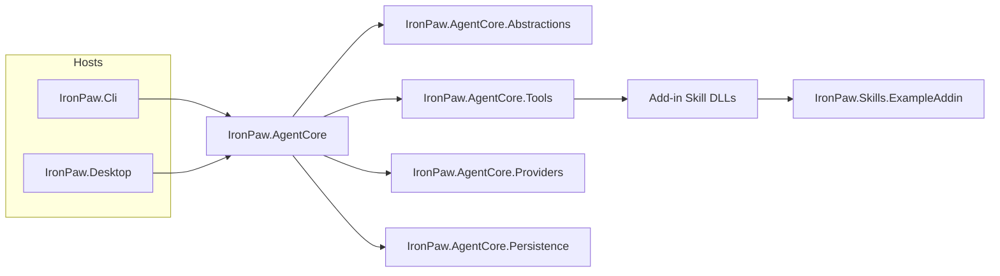
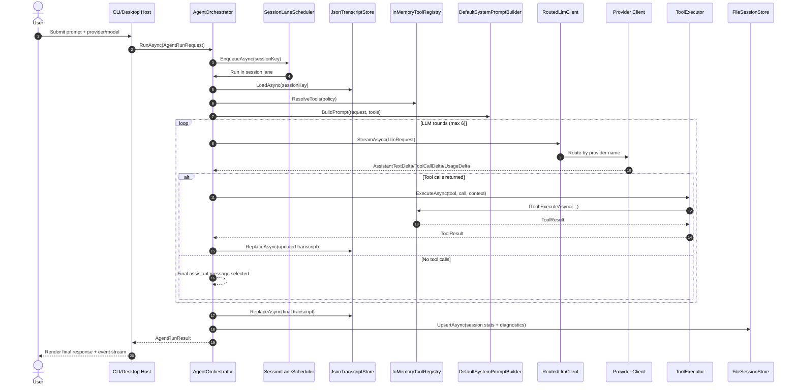

# IronPaw

`IronPaw` is a .NET solution generated from `deep-research-report.md`, following an OpenClaw-inspired architecture:
- headless agent core
- tool pipeline with policy filtering
- durable session + transcript storage
- event-stream-driven desktop UI
- provider routing (`local`, `openai`, `ollama`, `lmstudio`, `anthropic`)
- add-in skill system with dynamic discovery

## Architecture View

IronPaw is structured as host applications (`Desktop`, `Cli`) over a shared headless engine (`AgentCore`) with explicit boundaries for tools, providers, persistence, and abstractions.



## Request Lifecycle



## Documentation

**Start here:** [Getting Started](docs/getting-started.md)

### Tutorials

| Tutorial | Description |
|----------|-------------|
| [Interactive Mode](docs/tutorials/interactive-mode.md) | CLI REPL, slash commands, sessions |
| [Using Providers](docs/tutorials/using-providers.md) | OpenAI, Anthropic, Ollama, LM Studio setup |
| [Memory & Review](docs/tutorials/memory-and-review.md) | Persistent memory and task history |
| [Creating a Skill Add-in](docs/tutorials/creating-a-skill-addin.md) | Build your own tools |
| [Embedding IronPaw](docs/tutorials/embedding-ironpaw.md) | Use IronPaw as a library in your app |

### Examples

| Example | Description |
|---------|-------------|
| [Weather Skill](docs/examples/weather-skill.md) | Complete worked example of a custom skill |

### Reference

- [Skills Add-ins](docs/skills-addins.md)

### Project README Index

- [src/IronPaw.AgentCore.Abstractions/README.md](src/IronPaw.AgentCore.Abstractions/README.md)
- [src/IronPaw.AgentCore/README.md](src/IronPaw.AgentCore/README.md)
- [src/IronPaw.AgentCore.Tools/README.md](src/IronPaw.AgentCore.Tools/README.md)
- [src/IronPaw.AgentCore.Persistence/README.md](src/IronPaw.AgentCore.Persistence/README.md)
- [src/IronPaw.AgentCore.Providers/README.md](src/IronPaw.AgentCore.Providers/README.md)
- [src/IronPaw.Cli/README.md](src/IronPaw.Cli/README.md)
- [src/IronPaw.Desktop/README.md](src/IronPaw.Desktop/README.md)
- [src/IronPaw.Skills.ExampleAddin/README.md](src/IronPaw.Skills.ExampleAddin/README.md)

## Solution Layout

- `src/IronPaw.AgentCore.Abstractions`: shared contracts, DTOs, and runtime interfaces.
- `src/IronPaw.AgentCore`: orchestration loop, lane scheduler, prompt/safety pipeline.
- `src/IronPaw.AgentCore.Tools`: built-in tools, tool policy pipeline, and add-in skill loading.
- `src/IronPaw.AgentCore.Persistence`: session/transcript stores with file-safe semantics.
- `src/IronPaw.AgentCore.Providers`: `ILLMClient` implementations and provider routing.
- `src/IronPaw.Cli`: Spectre.Console command-center host for terminal execution.
- `src/IronPaw.Desktop`: WPF host for interactive run/event visualization.
- `src/IronPaw.Skills.ExampleAddin`: sample add-in that contributes skills as tools.

## Build

```powershell
dotnet build IronPaw.sln
```

## Test

```powershell
dotnet test IronPaw.sln
```

## Run desktop app

```powershell
dotnet run --project src/IronPaw.Desktop
```

## Run CLI

```powershell
dotnet run --project src/IronPaw.Cli -- --provider local --prompt "Create a plan and write it to Plan.md"
dotnet run --project src/IronPaw.Cli -- --list-skills
```

Live provider examples:

```powershell
dotnet run --project src/IronPaw.Cli -- --provider openai --model gpt-4o-mini --prompt "Summarize the project status."
dotnet run --project src/IronPaw.Cli -- --provider anthropic --model claude-3-5-haiku-latest --prompt-file .\deep-research-report.md
dotnet run --project src/IronPaw.Cli -- --provider ollama --model llama3.2 --prompt "Summarize the project status."
dotnet run --project src/IronPaw.Cli -- --provider lmstudio --model local-model --prompt "Summarize the project status."
```

## Provider credentials

Set environment variables before launching for live providers:

```powershell
$env:OPENAI_API_KEY="your-openai-key"
$env:ANTHROPIC_API_KEY="your-anthropic-key"
$env:OLLAMA_BASE_URL="http://localhost:11434"
$env:LMSTUDIO_BASE_URL="http://localhost:1234"
# Optional for local OpenAI-compatible endpoints:
$env:OLLAMA_API_KEY="ollama"
$env:LMSTUDIO_API_KEY="lm-studio"
```

In the UI:
- choose `local`, `openai`, `ollama`, `lmstudio`, or `anthropic`
- choose model id for that provider

## Skills As Add-ins

`ISkillAddin` assemblies are discovered at runtime from:
- `.\addins\skills`
- `%LOCALAPPDATA%\IronPaw\skills`

The example add-in project is included in the solution and auto-copies its built DLL into `addins/skills` after build.

Skill add-ins expose one or more `ISkill` implementations, which are automatically adapted into tools (group: `group:skills`) and become callable by the model.

Implementation details:
- `docs/skills-addins.md`

To inspect loaded skills from terminal:

```powershell
dotnet run --project src/IronPaw.Cli -- --list-skills
```

## First run suggestion

Use a prompt like:

```text
Create a project plan for an agent architecture and write it to Plan.md.
```

The local provider will emit a `write_file` tool call, persist transcript/session state, and show lifecycle/tool events in the UI.
