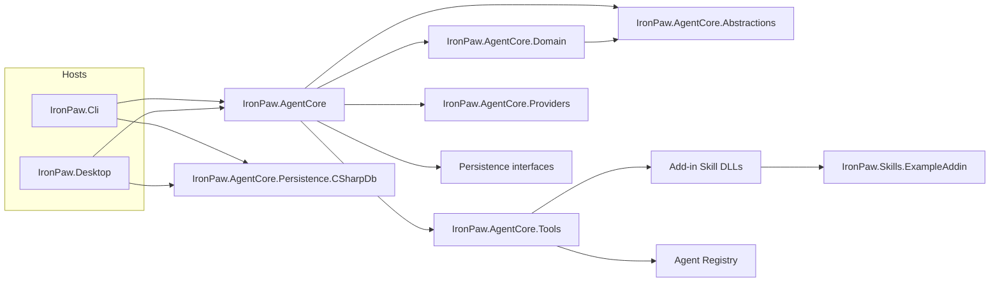
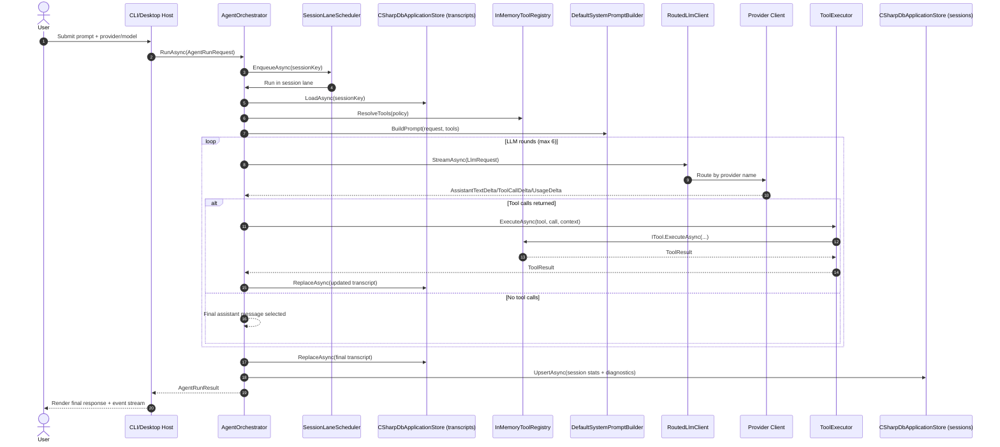

# IronPaw

`IronPaw` is a .NET 10 agent orchestration framework following an OpenClaw-inspired architecture:
- headless agent core with event-driven UI hosts (CLI + WPF Desktop)
- **multi-agent delegation** with named specialist agents and supervisor pattern
- tool pipeline with profile-based policy filtering
- durable session + transcript storage with persistent memory
- provider routing (`local`, `openai`, `ollama`, `lmstudio`, `anthropic`)
- add-in skill system with dynamic discovery and runtime Roslyn compilation
- task review and run history tracking
- durable dependency graphs with isolated file tasks, shared budgets and separate artifact acceptance
- shared user settings for CLI/Desktop and a pinned-SDK Windows validation workflow
- a desktop execution timeline for dependency waits, current work, host acceptance, saved activity and shared budgets
- optional execution traces/metrics and bounded desktop event delivery that isolates presentation failures
- MCP connectors in CLI/Desktop and embedding hosts with reviewed grants, controlled transports and durable replay
- optional JavaScript browsing with isolated Chromium contexts and saved site/mutation grants
- self-contained Windows bundles, published-application smoke checks and dependency maintenance workflows

Both apps read `%LOCALAPPDATA%/IronPaw/settings.json` for new-run defaults; `IRONPAW_CONFIG` selects
another reviewed file. The CLI also supports `--config` and standalone `--validate-config`.
See [shared configuration and repeatable validation](docs/runtime-configuration.md). Run
`./eng/Validate.ps1` for the Release build, full test suite and example-configuration checks used by CI.
See [MCP connector setup](docs/mcp-connectors.md), [JavaScript browsing](docs/browser-runtime.md),
[Windows bundles](docs/releases.md) and [delivery qualification](docs/delivery-qualification.md).

Both apps persist sessions, transcripts, memories, run history and agent messages in
`%LOCALAPPDATA%/IronPaw/state/application.cdb`. Existing JSON data imports once, preserving
original files. Close older IronPaw instances before the first migration. Existing SQLite files
are preserved and are not imported. Workspace workflow journals keep their separate paths.
See [application storage and migration](docs/application-storage.md).

## Architecture View

IronPaw is structured as host applications (`Desktop`, `Cli`) over a shared headless engine (`AgentCore`) with explicit boundaries for tools, providers, persistence, and abstractions.



## Request Lifecycle



## Documentation

**Start here:** [Getting Started](docs/getting-started.md)

### Tutorials

| Tutorial | Description |
|----------|-------------|
| [Interactive Mode](docs/tutorials/interactive-mode.md) | CLI REPL, slash commands, sessions |
| [Using Providers](docs/tutorials/using-providers.md) | OpenAI, Anthropic, Ollama, LM Studio setup |
| [Memory & Review](docs/tutorials/memory-and-review.md) | Persistent memory and task history |
| [Creating a Skill Add-in](docs/tutorials/creating-a-skill-addin.md) | Build your own tools |
| [Embedding IronPaw](docs/tutorials/embedding-ironpaw.md) | Use IronPaw as a library in your app |

### Examples

| Example | Description |
|---------|-------------|
| [Weather Skill](docs/examples/weather-skill.md) | Complete worked example of a custom skill |
| [Agent Messaging Workflow](docs/examples/agent-messaging-workflow.md) | End-to-end delegation + inter-agent messaging + observability events |
| [Web Browser Agent Workflow](docs/examples/web-browser-agent-workflow.md) | Delegate web navigation/extraction to the `web_browser` specialist |

### Reference

- [Skills Add-ins](docs/skills-addins.md)

### Project README Index

- [src/IronPaw.AgentCore.Abstractions/README.md](src/IronPaw.AgentCore.Abstractions/README.md)
- [src/IronPaw.AgentCore.Domain/README.md](src/IronPaw.AgentCore.Domain/README.md)
- [src/IronPaw.AgentCore/README.md](src/IronPaw.AgentCore/README.md)
- [src/IronPaw.AgentCore.Tools/README.md](src/IronPaw.AgentCore.Tools/README.md)
- [src/IronPaw.AgentCore.Persistence/README.md](src/IronPaw.AgentCore.Persistence/README.md)
- [src/IronPaw.AgentCore.Providers/README.md](src/IronPaw.AgentCore.Providers/README.md)
- [src/IronPaw.Cli/README.md](src/IronPaw.Cli/README.md)
- [src/IronPaw.Desktop/README.md](src/IronPaw.Desktop/README.md)
- [src/IronPaw.Skills.ExampleAddin/README.md](src/IronPaw.Skills.ExampleAddin/README.md)

## Solution Layout

- `src/IronPaw.AgentCore.Abstractions`: shared contracts, DTOs, and runtime interfaces (tools, skills, LLM, sessions, memory, run history).
- `src/IronPaw.AgentCore.Domain`: pure task-graph validation, result consistency and progress inspection shared by runtime and persistence.
- `src/IronPaw.AgentCore`: orchestration loop, lane scheduler, system prompt builder with memory injection, transcript repair and truncation.
- `src/IronPaw.AgentCore.Tools`: built-in tools (file I/O, memory, review, web browsing/extraction, runtime skill creation, agent delegation), policy pipeline, schema normalization, agent registry, and add-in skill loading.
- `src/IronPaw.AgentCore.Persistence`: file-based stores for sessions, transcripts, memory, and run history.
- `src/IronPaw.AgentCore.Providers`: `ILlmClient` implementations (OpenAI, Anthropic, Ollama, LM Studio, local rule-based), provider routing, shared defaults, and factory wiring.
- `src/IronPaw.Cli`: Spectre.Console terminal host with interactive REPL, slash commands, memory management, and task review.
- `src/IronPaw.Desktop`: WPF host for interactive run/event visualization (Windows only).
- `src/IronPaw.Skills.ExampleAddin`: sample add-in that contributes skills as tools (`text_stats`, `slugify`).

## Build

```powershell
dotnet build IronPaw.sln
```

## Test

```powershell
dotnet test IronPaw.sln
```

## Run desktop app

```powershell
dotnet run --project src/IronPaw.Desktop
```

## Run CLI

```powershell
dotnet run --project src/IronPaw.Cli -- --provider local --prompt "Create a plan and write it to Plan.md"
dotnet run --project src/IronPaw.Cli -- --list-skills
```

Live provider examples:

```powershell
dotnet run --project src/IronPaw.Cli -- --provider openai --model gpt-4o-mini --prompt "Summarize the project status."
dotnet run --project src/IronPaw.Cli -- --provider anthropic --model claude-3-5-haiku-latest --prompt-file .\deep-research-report.md
dotnet run --project src/IronPaw.Cli -- --provider ollama --model llama3.2 --prompt "Summarize the project status."
dotnet run --project src/IronPaw.Cli -- --provider lmstudio --model local-model --prompt "Summarize the project status."
```

## Provider credentials

Set environment variables before launching for live providers:

```powershell
$env:OPENAI_API_KEY="your-openai-key"
$env:ANTHROPIC_API_KEY="your-anthropic-key"
$env:OLLAMA_BASE_URL="http://localhost:11434"
$env:LMSTUDIO_BASE_URL="http://localhost:1234"
# Optional for local OpenAI-compatible endpoints:
$env:OLLAMA_API_KEY="ollama"
$env:LMSTUDIO_API_KEY="lm-studio"
```

In the UI:
- choose `local`, `openai`, `ollama`, `lmstudio`, or `anthropic`
- choose model id for that provider

## Skills As Add-ins

`ISkillAddin` assemblies are discovered at runtime from:
- `.\addins\skills`
- `%LOCALAPPDATA%\IronPaw\skills`

The example add-in project is included in the solution and auto-copies its built DLL into `addins/skills` after build.

Skill add-ins expose one or more `ISkill` implementations, which are automatically adapted into tools (group: `group:skills`) and become callable by the model.

Implementation details:
- `docs/skills-addins.md`

To inspect loaded skills from terminal:

```powershell
dotnet run --project src/IronPaw.Cli -- --list-skills
```

## Multi-Agent Delegation

Embedding hosts can also use `AgentTaskGraphRunner` for durable dependency scheduling with
isolated Git snapshots, scoped file tools and the shared CSharpDB budget ledger. Accepted predecessor
file changes compose into dependent tasks with pinned inputs and conflict detection. Its built-in
verifier checks explicitly configured artifact integrity criteria. Optional owner-authorized command
profiles add durable build/test receipts against exact disposable copies of the combined candidate;
uncertain process effects require reconciliation. The local worker uses host OS authority and is not
an OS sandbox. CLI and Desktop graph controls support inspection, pause/resume, recovery and explicit
reconciliation. A controlled replay corpus exercises coding and failure workflows against a direct
strategy; [live quality/cost/latency qualification remains unestablished](docs/orchestration-evaluations.md).
Its future provider, model and total spending cap are configurable through a
[disabled-by-default settings file](docs/orchestration-evaluations.md#live-comparison-configuration).
See [the core API and example](src/IronPaw.AgentCore/README.md#isolated-agent-task-graphs).

IronPaw supports multi-agent orchestration through a supervisor/specialist pattern. A top-level agent can delegate tasks to named specialist agents using the `invoke_agent` tool.

### How it works

1. **Define agents** — register `AgentDefinition` records with unique IDs, system prompts, tool policies, and optional provider/model overrides via the `IAgentRegistry`.
2. **Supervisor delegates** — when the `invoke_agent` tool is available (Full profile), the LLM can delegate tasks to specialist agents by name.
3. **Isolated execution** — each sub-agent gets its own ephemeral session (transcript isolation), runs through the same `AgentOrchestrator`, and returns its final message as a tool result to the parent.
4. **Event attribution** — all events from sub-agents are tagged with `@agentId` for clear attribution in the event stream.

Default specialists include:
- `codegen` — implementation-focused coding agent
- `reviewer` — correctness/regression review agent
- `web_browser` — web navigation + structured extraction agent

### Agent tools (`group:agents`)

| Tool | Description |
|------|-------------|
| `invoke_agent` | Delegate a task to a specialist agent by ID |
| `list_agents` | List all registered agents and their descriptions |

### Messaging tools (`group:messaging`)

| Tool | Description |
|------|-------------|
| `send_agent_message` | Send a scoped message to another agent |
| `read_agent_messages` | Read pending scoped messages for the current agent |

### Web tools (`group:web`)

| Tool | Description |
|------|-------------|
| `web_navigate` | Open pages, follow links/click targets, and submit forms with session state |
| `web_extract_structured` | Extract metadata, tables, and lists from the active browser session |

### Recursion safety

- `SubagentDepth` increments on each delegation level (max depth: 3 by default)
- Sub-agents cannot create runtime skills (`group:runtime` filtered at depth > 0)
- Each agent has its own `MaxRounds` bound

### Programmatic registration

```csharp
var agentRegistry = bootstrap.AgentRegistry;
agentRegistry.Register(new AgentDefinition(
    AgentId: "coder",
    DisplayName: "Coder",
    Description: "Writes and refactors code",
    SystemPrompt: "You are a coding specialist. Write clean, tested code.",
    ToolPolicy: new ToolSelectionPolicy(ToolProfile.Coding)));
```

## First run suggestion

Use a prompt like:

```text
Create a project plan for an agent architecture and write it to Plan.md.
```

The local provider will emit a `write_file` tool call, persist transcript/session state, and show lifecycle/tool events in the UI.
