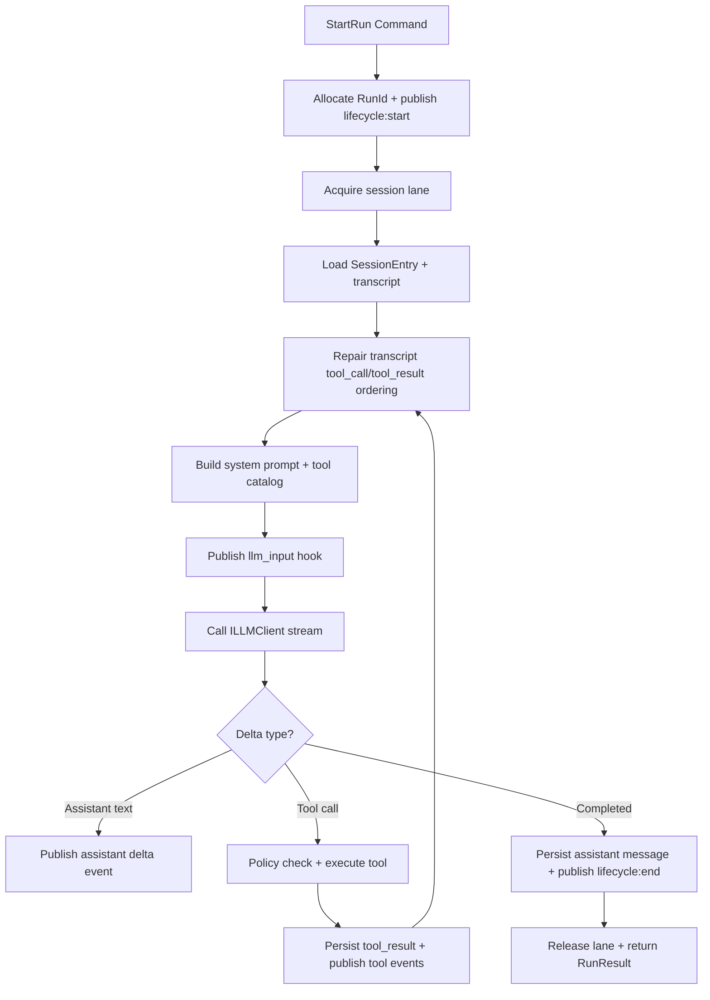

# OpenClaw-Inspired Agent Architecture for a .NET Windows Desktop Application

## Constraints and allowed sources

This report **ONLY** uses source material from **github.com**, specifically the **openclaw/openclaw** repository (code, docs, and repository-contained issues/discussions when relevant). If a detail is not present in that repository, it is explicitly marked **unspecified**. citeturn20view0turn6view0

Allowed source(s) (as required):  
```text
github.com — openclaw/openclaw repository only
```

Repository file links referenced throughout (GitHub “blob” URLs):  
```text
https://github.com/openclaw/openclaw/blob/main/README.md
https://github.com/openclaw/openclaw/blob/main/docs/pi.md

https://github.com/openclaw/openclaw/blob/main/src/auto-reply/reply/agent-runner-execution.ts
https://github.com/openclaw/openclaw/blob/main/src/agents/pi-embedded-runner/run.ts
https://github.com/openclaw/openclaw/blob/main/src/agents/pi-embedded-runner/run/attempt.ts
https://github.com/openclaw/openclaw/blob/main/src/agents/pi-embedded-runner/lanes.ts
https://github.com/openclaw/openclaw/blob/main/src/process/command-queue.ts

https://github.com/openclaw/openclaw/blob/main/src/agents/pi-tools.ts
https://github.com/openclaw/openclaw/blob/main/src/agents/pi-tools.schema.ts
https://github.com/openclaw/openclaw/blob/main/src/agents/pi-tool-definition-adapter.ts
https://github.com/openclaw/openclaw/blob/main/src/agents/tool-policy.ts
https://github.com/openclaw/openclaw/blob/main/src/agents/tools/common.ts

https://github.com/openclaw/openclaw/blob/main/src/config/sessions/store.ts
https://github.com/openclaw/openclaw/blob/main/src/config/sessions/paths.ts
https://github.com/openclaw/openclaw/blob/main/src/config/sessions/types.ts

https://github.com/openclaw/openclaw/blob/main/src/plugins/types.ts
https://github.com/openclaw/openclaw/blob/main/src/plugins/hook-runner-global.ts

https://github.com/openclaw/openclaw/blob/main/src/agents/session-tool-result-guard-wrapper.ts
https://github.com/openclaw/openclaw/blob/main/src/agents/session-transcript-repair.ts
https://github.com/openclaw/openclaw/blob/main/src/agents/pi-embedded-runner/tool-result-truncation.ts
```

## Executive summary

OpenClaw’s core “agentic” idea is not a single agent class; it is a **gateway/control-plane** that runs a durable, tool-augmented LLM loop with strong operational guardrails: per-session serialization (“lanes”), consistent tool registration/policy filtering, provider quirks normalization (schemas, role ordering, etc.), and robust persistence/repair of session transcripts. citeturn20view0turn21view0turn21view1turn17view0turn14view1turn25view1

A Windows/.NET desktop application adopting OpenClaw as architectural inspiration should mirror the separation OpenClaw creates in practice: keep the **agent engine headless and UI-agnostic**, expose a **command + event stream surface**, implement **durable session + transcript persistence**, and make tools a first-class extension point with a policy pipeline and lifecycle hooks. citeturn20view0turn19view0turn15view0turn16view1turn12view0

The most directly portable patterns for an experienced .NET engineer are:

- **Orchestrator + retry/fallback loop** with a stable `runId`, streaming/event normalization, and explicit recovery paths for context overflow, ordering issues, and transient failures. citeturn19view0turn18view0  
- **Tool pipeline**: authoritative tool list creation (`createOpenClawCodingTools`), policy filtering (profiles + group policies + sandbox + subagent depth), then schema normalization, then hook-wrapping and cancellation support. citeturn17view0turn14view1turn22view0  
- **Windows-safe persistence**: session store caching/TTL, file rotation, and explicit Windows retry logic around atomic writes/reads. citeturn12view0  
- **Transcript repair and tool-result safety**: sanitize tool-call/tool-result pairing and optionally synthesize missing tool results to preserve provider acceptance, plus truncation of oversized tool results to reduce context blowups. citeturn25view1turn27view0turn25view0

## OpenClaw architecture and execution model

### Control-plane orientation and integration style

OpenClaw positions itself as a “local-first Gateway” and “single control plane for sessions, channels, tools, and events.” Even if you are not building the multi-channel gateway part, this statement captures its architectural bias: centralized orchestration and shared state across many surfaces. citeturn20view0

A key implementation choice documented in the repo is **embedding** the Pi agent SDK rather than driving a subprocess: OpenClaw “directly imports and instantiates” the Pi `AgentSession` via `createAgentSession()`, enabling custom tool injection, system prompt customization, and persistence/compaction. citeturn6view0turn12view1

OpenClaw’s `docs/pi.md` effectively provides a structural map of the runtime: `runEmbeddedPiAgent()` is the main entry, `attempt.ts` is the “single attempt” assembly point, and there are separate modules for history limiting, compaction, tool split, schema normalization, lanes, and active run tracking. citeturn6view0

### Core abstractions in practice: orchestration, tools, state, hooks

OpenClaw’s “agent run” is layered:

- **Outer orchestration**: `runAgentTurnWithFallback()` (reply pipeline) handles `runId` setup, streaming normalization, fallback model selection, delivery pipeline behavior, and recovery paths for context overflow and ordering conflicts. citeturn19view0  
- **Inner embedded run**: `runEmbeddedPiAgent()` enforces per-session queueing (lanes), runs early `before_agent_start` hooks, resolves the model/auth context window guardrails, and maintains a careful usage accumulator (notably: only last cache read/write should be used for context-size reporting to avoid inflated totals across tool-call round trips). citeturn18view0turn21view0turn21view1  
- **Attempt composition**: `runEmbeddedAttempt()` builds the sandbox/workspace context, loads skills prompt/context files, constructs tools, builds the system prompt, opens/repairs session manager/transcript, creates the agent session (`createAgentSession`), applies system prompt override, then streams and handles tool loop. citeturn12view1turn24view1

**Per-session lanes (serialization)** are explicit. A session lane name is derived via `resolveSessionLane(key)` to `session:${key}` and used to serialize work per session. The queue itself (`enqueueCommandInLane`) is a minimal in-process scheduler with per-lane concurrency limits and safety around lane resets. citeturn21view0turn21view1

**Tools** are treated as a system with multiple concerns:

- Tool groupings and profiles (`minimal`, `coding`, `messaging`, `full`) define allow/deny lists and canonical tool groups like `group:fs`, `group:runtime`, `group:sessions`, `group:web`, etc. citeturn22view0  
- Tool construction (`createOpenClawCodingTools`) merges config from global + per-agent sources, adds channel tools and OpenClaw native tools, applies owner-only restrictions, then applies a policy pipeline and schema normalization (`normalizeToolParameters`) before hooking and abort wrapping. citeturn17view0turn14view1turn22view0  
- Tool execution is mediated by an adapter (`toToolDefinitions`) that bridges differing execute signatures, runs `before_tool_call` and `after_tool_call` hooks, and converts tool failures into structured `jsonResult` error payloads rather than crashing the whole agent loop. citeturn14view0turn26view0turn15view0

**Hooks / plugins** are first-class. The plugin API supports tool factories, commands, services, channel registrations, and a large hook set including (not exhaustive): `before_model_resolve`, `before_prompt_build`, `before_agent_start`, `llm_input`, `llm_output`, `before_tool_call`, `after_tool_call`, `tool_result_persist`, and lifecycle points like `gateway_start/stop`. A global hook runner is initialized from a plugin registry and can be invoked from anywhere. citeturn15view0turn21view2

### Prompt, state, and transcript safety

OpenClaw builds a **structured system prompt** with dedicated sections (skills, memory recall, messaging routing, docs, safety, tooling list, etc.). The system prompt builder has explicit prompt modes: `full`, `minimal`, `none` (notably used for subagents). It dynamically includes sections based on available tools (e.g., memory tools) and runtime channel capabilities (e.g., inline buttons). citeturn23view0turn24view1

Runtime metadata (timezone and current time; repo root detection via walking up to `.git`) is assembled in system prompt params building. citeturn24view0

State persistence is explicit and Windows-aware:

- Session entries carry metadata such as `sessionId`, `updatedAt`, `sessionFile`, model/provider overrides, usage totals, compaction counters, queue modes, and even a structured “system prompt report” that records prompt/tool schema character counts. citeturn16view1turn24view2  
- The session store is cached with TTL and uses **Windows-specific retry logic** because concurrent readers can observe transient zero-byte files during a temp-file + rename write path. It also supports pruning/capping and rotation of the session store file. citeturn12view0  
- Transcript file paths are validated and forced to remain within a sessions directory, with careful handling of legacy absolute paths and agentId derivation from path patterns. citeturn16view0

Finally, OpenClaw includes significant transcript safety:

- It repairs tool-call/tool-result pairing: strict providers can reject transcripts if tool results are not immediately after tool calls; OpenClaw can move results, drop duplicates/orphans, and insert synthetic error tool results. citeturn25view1  
- It mitigates context blowups from large tool results via truncation logic that caps tool result size to a share of context window and can rewrite the session branch from before the first oversized tool result. citeturn27view0turn18view0  
- It installs a session tool-result guard wrapper that can call hooks like `before_message_write` and `tool_result_persist` before persisting messages, and exposes `flushPendingToolResults` for teardown safety. citeturn25view0turn15view0

### OpenClaw code snippets to study (adapted, non-verbatim)

Due to quotation limits, the snippets below are **adapted structural excerpts** (not verbatim) capturing the core logic shape. Each references the original file.

**Orchestration + fallback + recovery loop** (adapted)  
```ts
// src/auto-reply/reply/agent-runner-execution.ts (adapted)
async function runAgentTurnWithFallback(...) {
  const runId = opts.runId ?? uuid();
  while (true) {
    try {
      const { provider, model, result } = await runWithModelFallback(...);
      // normalize streaming text (heartbeat/silent replies)
      // runEmbeddedPiAgent(...) with onAgentEvent / onToolResult / onBlockReply
      // special-case: embeddedError.kind === "role_ordering" => reset session
      return result;
    } catch (err) {
      // detect context overflow / compaction failure / role ordering
      // auto-reset transcript on corruption patterns
      // retry transient HTTP errors with delay
    }
  }
}
```
citeturn19view0

**Per-session lanes + early hook override** (adapted)  
```ts
// src/agents/pi-embedded-runner/run.ts (adapted)
export async function runEmbeddedPiAgent(params) {
  const sessionLane = resolveSessionLane(params.sessionKey ?? params.sessionId);
  return enqueueInLane(sessionLane, async () => {
    await ensureModelsJson(...);
    const early = await hooks.before_agent_start({ prompt: params.prompt });
    if (early?.providerOverride) provider = early.providerOverride;
    if (early?.modelOverride) modelId = early.modelOverride;

    const { model, authStorage, modelRegistry } = resolveModel(provider, modelId, ...);
    // usage accumulator uses lastCacheRead/lastCacheWrite (not sum) for context reporting
    return await runEmbeddedAttempt(...);
  });
}
```
citeturn18view0turn21view0turn21view1

**Tool construction pipeline** (adapted)  
```ts
// src/agents/pi-tools.ts (adapted)
export function createOpenClawCodingTools(opts) {
  const policy = resolveEffectiveToolPolicy(...);
  const groupPolicy = resolveGroupToolPolicy(...);
  const tools = [
    ...baseCodingToolsMinusBash(),
    execTool(...),
    processTool(...),
    ...channelTools(),
    ...openclawNativeTools(...)
  ];

  const ownerFiltered = applyOwnerOnlyToolPolicy(tools, opts.senderIsOwner === true);
  const policyFiltered = applyToolPolicyPipeline(ownerFiltered, [policy, groupPolicy, sandboxPolicy, subagentPolicy]);

  const schemaNormalized = policyFiltered.map(t => normalizeToolParameters(t, { modelProvider: opts.modelProvider }));
  return schemaNormalized.map(t => wrapBeforeToolCallHook(wrapAbortSignal(t)));
}
```
citeturn17view0turn14view1turn22view0

**Tool definition adapter + after_tool_call hook** (adapted)  
```ts
// src/agents/pi-tool-definition-adapter.ts (adapted)
export function toToolDefinitions(tools) {
  return tools.map(tool => ({
    name: tool.name,
    parameters: tool.parameters,
    execute: async (...args) => {
      const { toolCallId, params, signal } = splitArgs(args);
      const before = await before_tool_call(tool.name, params);
      if (before.blocked) throw new Error(before.reason);

      try {
        const result = await tool.execute(toolCallId, before.params, signal);
        await after_tool_call(tool.name, before.params, result);
        return result;
      } catch (e) {
        if (signal?.aborted) throw e;
        const errorResult = jsonResult({ status: "error", tool: tool.name, error: String(e) });
        await after_tool_call(tool.name, params, /*error*/ String(e));
        return errorResult;
      }
    }
  }));
}
```
citeturn14view0turn26view0turn15view0

## Translating OpenClaw concepts to a .NET agent core

### Recommended .NET solution layout and namespaces

The OpenClaw pattern that matters most for a desktop application is **headless core + evented orchestration + durable persistence**. OpenClaw’s `runAgentTurnWithFallback` and lane queueing show that even in-process, it behaves like an engine behind multiple surfaces. citeturn19view0turn21view1turn20view0

Opinionated solution layout:

- `MyProduct.AgentCore.Abstractions`  
  Pure contracts (no DI package references).
- `MyProduct.AgentCore`  
  Orchestrator, tool policy pipeline, prompt builder, hook pipeline, event model.
- `MyProduct.AgentCore.Persistence`  
  Session store, transcripts/event log, compaction/truncation helpers.
- `MyProduct.AgentCore.Tools`  
  Built-in tools (fs, process, web, memory), tool metadata, schema generation.
- `MyProduct.AgentCore.Providers`  
  LLM provider adapters and routing.
- `MyProduct.Desktop` *(WPF or WinUI 3)*  
  UI (MVVM), binds to streaming `AgentEvent`s.
- Optional later: `MyProduct.AgentHost.Service`  
  Headless host (Windows Service / tray) if you want always-on automation.

Namespace conventions that map cleanly to OpenClaw:

- `MyProduct.AgentCore.Orchestration` (OpenClaw: reply runner + embedded runner) citeturn19view0turn18view0  
- `MyProduct.AgentCore.Tools` (OpenClaw: pi-tools + adapter + common) citeturn17view0turn14view0turn26view0  
- `MyProduct.AgentCore.Hooks` (OpenClaw: plugins/types + global runner) citeturn15view0turn21view2  
- `MyProduct.AgentCore.Storage` (OpenClaw: sessions store + paths + types) citeturn12view0turn16view0turn16view1  
- `MyProduct.AgentCore.Safety` (OpenClaw: transcript repair + tool result truncation) citeturn25view1turn27view0  
- `MyProduct.AgentCore.Concurrency` (OpenClaw: per-session lanes) citeturn21view0turn21view1

### Mapping table: OpenClaw concepts → .NET types

| OpenClaw concept | Concrete manifestation in repo | Recommended .NET analogue | Suggested C# types |
|---|---|---|---|
| Run orchestration w/ fallback | `runAgentTurnWithFallback()` | Orchestrator façade coordinating provider selection, retries, output normalization | `IAgentOrchestrator`, `AgentOrchestrator`, `IRunRecoveryPolicy` citeturn19view0 |
| Embedded agent execution | `runEmbeddedPiAgent()` + `runEmbeddedAttempt()` | Engine loop: build prompt, loop tool-calls, persist | `IAgentEngine`, `AgentEngine`, `AgentTurnLoop` citeturn18view0turn12view1 |
| Lanes / per-session serialization | `resolveSessionLane` + `enqueueCommandInLane` | Keyed concurrency control per `SessionKey` | `ISessionLaneScheduler` (Keyed `SemaphoreSlim` / `Channel<T>`), `LaneId` citeturn21view0turn21view1 |
| Tool registry + policy pipeline | `createOpenClawCodingTools`, `applyToolPolicyPipeline`, profiles/groups | Tool composition root + policy filters | `IToolRegistry`, `IToolPolicy`, `ToolProfile`, `ToolGroup` citeturn17view0turn22view0 |
| Tool schema normalization | `normalizeToolParameters` | Normalize JSON Schema once per tool/provider | `IToolSchemaNormalizer`, `ProviderQuirkPolicy` citeturn14view1 |
| Tool definition adapter + hooks | `toToolDefinitions()` | Adapter that wraps execution with hooks, errors -> toolResult | `ToolExecutor`, `ToolMiddleware`, `IToolHookPipeline` citeturn14view0turn15view0 |
| Session store + metadata | `SessionEntry` + `loadSessionStore` | Durable session metadata with TTL caching and Windows-safe writes | `ISessionStore`, `SessionEntry`, `SessionSettings` citeturn16view1turn12view0 |
| Transcript file path containment | `resolvePathWithinSessionsDir` | Safe path resolution & containment for transcript residency | `IPathPolicy`, `TranscriptPathResolver` citeturn16view0 |
| Transcript repair | `repairToolUseResultPairing` | Repair step pre-LLM-call to satisfy provider constraints | `ITranscriptSanitizer`, `ToolCallPairingRepair` citeturn25view1 |
| Oversized tool result truncation | `truncateOversizedToolResultsInSession` | Context-safety truncation with rewrite-from-branch semantics | `IToolResultSizer`, `ToolResultTruncator` citeturn27view0 |
| Plugin hook surface | `PluginHookName` + global runner | Pluggable lifecycle events (internal + third-party) | `IAgentHook`, `IHookRunner`, `HookName` citeturn15view0turn21view2 |

### Concrete C# interfaces and idiomatic patterns

The shape below is deliberately aligned with OpenClaw’s event-driven model (agent events, tool hooks, per-run `runId`). OpenClaw explicitly uses `runId` and emits events with stream types like lifecycle/tool/assistant; you should preserve that in .NET. citeturn19view0turn21view2

Core primitives:

```csharp
namespace MyProduct.AgentCore.Abstractions;

public readonly record struct SessionKey(string Value);
public readonly record struct RunId(string Value);

public enum AgentEventStream
{
    Lifecycle,
    Assistant,
    Reasoning,
    Tool,
    Compaction,
    Diagnostics
}

public sealed record AgentEvent(
    RunId RunId,
    SessionKey SessionKey,
    AgentEventStream Stream,
    DateTimeOffset Timestamp,
    IReadOnlyDictionary<string, object?> Data
);

public interface IAgentEventSink
{
    ValueTask PublishAsync(AgentEvent evt, CancellationToken ct);
}

// Tool model mirrors OpenClaw's name + parameters schema + toolResult content shape. citeturn26view0turn14view1
public interface ITool
{
    string Name { get; }
    string Description { get; }
    JsonDocument ParametersSchema { get; }
    Task<ToolResult> ExecuteAsync(ToolCall call, ToolExecutionContext ctx, CancellationToken ct);
}

public sealed record ToolCall(string ToolCallId, string ToolName, JsonElement Arguments);

public sealed record ToolResult(
    IReadOnlyList<ToolContentPart> Content,
    object? Details = null
);

public abstract record ToolContentPart;
public sealed record ToolText(string Text) : ToolContentPart;
public sealed record ToolImage(string Base64, string MimeType) : ToolContentPart;
```

Tool execution middleware (OpenClaw analog: `toToolDefinitions` wrapping + hooks + error normalization). citeturn14view0turn15view0turn26view0

```csharp
public interface IToolHookPipeline
{
    ValueTask<BeforeToolCallResult> BeforeAsync(ToolCall call, ToolExecutionContext ctx, CancellationToken ct);
    ValueTask AfterAsync(ToolCall call, ToolExecutionContext ctx, ToolResult? result, Exception? error, CancellationToken ct);
}

public sealed record BeforeToolCallResult(bool Blocked, string? Reason, JsonElement? AdjustedArguments);

public sealed class ToolExecutor
{
    private readonly IToolHookPipeline _hooks;

    public ToolExecutor(IToolHookPipeline hooks) => _hooks = hooks;

    public async Task<ToolResult> ExecuteAsync(ITool tool, ToolCall call, ToolExecutionContext ctx, CancellationToken ct)
    {
        var before = await _hooks.BeforeAsync(call, ctx, ct);
        if (before.Blocked) throw new InvalidOperationException(before.Reason ?? "Blocked by tool policy");

        var effectiveArgs = before.AdjustedArguments ?? call.Arguments;
        var effectiveCall = call with { Arguments = effectiveArgs };

        try
        {
            var result = await tool.ExecuteAsync(effectiveCall, ctx, ct);
            await _hooks.AfterAsync(effectiveCall, ctx, result, error: null, ct);
            return result;
        }
        catch (Exception ex) when (!ct.IsCancellationRequested)
        {
            // Normalize tool error into a ToolResult payload like OpenClaw jsonResult({status:"error"...}). citeturn14view0turn26view0
            var errorResult = new ToolResult(
                Content: new ToolContentPart[] { new ToolText($"{{\"status\":\"error\",\"tool\":\"{tool.Name}\",\"error\":\"{ex.Message}\"}}") },
                Details: new { status = "error", tool = tool.Name, error = ex.Message }
            );

            await _hooks.AfterAsync(effectiveCall, ctx, result: null, error: ex, ct);
            return errorResult;
        }
    }
}
```

Persistence model inspired by OpenClaw’s `SessionEntry` and session store architecture (metadata + usage + compaction + overrides). citeturn16view1turn12view0

```csharp
public sealed record SessionEntry(
    string SessionId,
    DateTimeOffset UpdatedAt,
    string? TranscriptPath,
    string? ProviderOverride,
    string? ModelOverride,
    int? CompactionCount,
    long? InputTokens,
    long? OutputTokens,
    long? TotalTokens,
    bool? TotalTokensFresh
);

public interface ISessionStore
{
    Task<SessionEntry?> GetAsync(SessionKey key, CancellationToken ct);
    Task UpsertAsync(SessionKey key, Func<SessionEntry?, SessionEntry> mutate, CancellationToken ct);
    Task<IDictionary<SessionKey, SessionEntry>> LoadAllAsync(CancellationToken ct);
}
```

### Representing and persisting state

OpenClaw uses a session store file with TTL caching and careful Windows retry semantics, plus transcript paths with containment checks. This suggests two strong .NET storage directions:

- **File-first (OpenClaw-like)**: JSON store + JSONL transcript per session (fast to inspect, easy to tail, compatible with the “event log” mental model). You must implement Windows-safe atomic write/retry similar to OpenClaw’s retries on win32 when file reads see empty or transient corrupt state. citeturn12view0turn16view0  
- **SQLite-first (desktop-idiomatic)**: SQLite for session metadata + messages + tool calls; optionally still write JSONL “debug transcript” for external inspection. OpenClaw does not mandate SQLite; this choice is **unspecified** in repo and therefore a .NET design decision.

Opinionated recommendation for Windows desktop: **SQLite for queryability + JSONL debug log per run**. You’ll want UI features like “search runs,” “filter tool calls,” “diff prompts,” and these are materially easier with SQLite. Keep JSONL as an export/forensic trail to preserve the OpenClaw inspectability benefit.

In either case, replicate OpenClaw’s **path containment guard** for any file path sourced from state (including legacy absolute paths). citeturn16view0

## Windows UI options and interaction patterns

### UI stack comparison

| Stack | Strengths for an agentic desktop app | Risks / tradeoffs | Fit vs OpenClaw patterns |
|---|---|---|---|
| WPF | Mature MVVM ecosystem, robust styling control, easiest to build rich diagnostics panels (transcript viewer, tool call inspector) | Less “modern Windows” feel unless you invest in styling | Excellent if you treat UI as a thin client over a headless engine (OpenClaw’s “control plane vs surfaces” separation) citeturn20view0 |
| WinUI 3 | Modern Windows App SDK controls and UX conventions | Bootstrapping and packaging complexity; dependency on WinAppSDK | Good if “modern Windows dashboard” is a priority; still recommend headless core |
| .NET MAUI | Best if you anticipate cross-platform UI later | Desktop UX quirks, fewer mature desktop-grade debugging controls | Only choose if cross-platform UI is a primary requirement now (unspecified by repo) |
| Headless service + separate UI | Strong separation; can later become tray app + Windows service; aligns with OpenClaw’s multi-surface model | More moving parts initially; IPC boundary design | Most faithful to OpenClaw’s conceptual model (“gateway control plane” plus clients) citeturn20view0 |

Opinionated recommendation: start with **WPF** (fastest path to a diagnostics-heavy tool) and architect the core as if it could later be hosted headlessly. “Headless from day one” is attractive, but on Windows it can slow iteration; in practice, you can keep the headless boundary at the assembly level first, then extract into a separate process if/when required.

### Interaction patterns to copy from OpenClaw

OpenClaw’s patterns that are directly portable to a desktop UI:

1. **Command → Event Stream**  
   OpenClaw emits structured agent events with stream categories (lifecycle/tool/assistant/etc.) and a stable `runId`. Your UI should subscribe to an in-process stream rather than polling. citeturn19view0turn21view2

2. **Per-session lanes**  
   OpenClaw serializes per-session work through a lane name derived from the session key. This prevents interleaving tool calls and transcript writes across concurrent turns. Copy this using keyed async locks or per-session `Channel<AgentCommand>`. citeturn21view0turn21view1turn18view0

3. **CQRS-ish split**  
   - Commands: `StartRun`, `CancelRun`, `ResetSession`, `CompactSession`, `UpdateSessionOverrides`, `RegisterTool`, `InstallPlugin`  
   - Queries: `GetSessionList`, `GetSessionEntry`, `GetTranscriptPage`, `GetToolCatalog`, `GetRunDiagnostics`  
   This mirrors OpenClaw’s separation between run logic and session store/transcript utilities. citeturn12view0turn16view1

### Mermaid architecture diagram

```mermaid
flowchart LR
  UI[Windows UI (WPF / WinUI 3)] -->|Commands| Host[AgentHost]
  Host -->|AgentEvent stream| UI

  Host --> Orchestrator[AgentOrchestrator<br/>runId + recovery]
  Orchestrator --> Lane[Per-session Lane Scheduler]
  Lane --> Engine[AgentEngine<br/>LLM + tool loop]

  Engine --> Prompt[Prompt Builder<br/>system prompt + context]
  Engine --> Tools[Tool Registry + Policy Pipeline]
  Engine --> Providers[ILLMClient Provider Adapters]
  Engine --> Store[Session Store + Transcript Log]

  Tools --> Hooks[Hook Pipeline<br/>before/after tool, llm_input/output]
  Store --> Repair[Transcript Repair + Tool Result Truncation]
```

The elements above correspond to concrete OpenClaw modules: orchestration (`runAgentTurnWithFallback`), lanes (`resolveSessionLane` + `enqueueCommandInLane`), tool policies and normalization (`createOpenClawCodingTools`, `normalizeToolParameters`), persistence (`loadSessionStore`, paths containment), and hooks (`plugins/types`, global hook runner). citeturn19view0turn21view0turn21view1turn17view0turn14view1turn12view0turn16view0turn15view0turn21view2

## Implementation start plan and instrumentation

### Minimal interfaces to implement first

OpenClaw’s layering indicates what must exist early for the system to “feel” correct:

1. **Orchestrator façade** (OpenClaw: `runAgentTurnWithFallback`) with stable `RunId`, recovery loop, and an event sink. citeturn19view0  
2. **Lane scheduler** for per-session serialization (OpenClaw: lane resolver + command queue). citeturn21view0turn21view1  
3. **Session store + transcript store** with Windows-safe semantics (OpenClaw: `loadSessionStore` retry logic, rotation, paths containment). citeturn12view0turn16view0turn16view1  
4. **Tool registry + policy pipeline + schema normalization** (OpenClaw: tool profiles/groups, tool pipeline, `normalizeToolParameters`). citeturn22view0turn17view0turn14view1  
5. **Tool execution middleware** (OpenClaw: `toToolDefinitions` + hooks + error normalization; and `jsonResult`). citeturn14view0turn26view0turn15view0  
6. **Transcript sanitizer** (OpenClaw: repair tool-use/tool-result pairing) before each LLM call. citeturn25view1  
7. **Oversized tool result truncator** (initially in-memory), to prevent tool outputs from dominating the context. citeturn27view0turn18view0

### Plugging an LLM provider from .NET: `ILLMClient`

OpenClaw’s plugin hook set explicitly defines `llm_input` and `llm_output` events containing system prompt, history messages, and usage. Design your .NET client to make these hook points natural. citeturn15view0turn18view0turn24view1

Sketch:

```csharp
public sealed record ChatMessage(string Role, object Content); // content can be string or block array if you support images/tools

public sealed record LlmToolDefinition(
    string Name,
    string Description,
    JsonDocument ParametersSchema
);

public sealed record LlmRequest(
    RunId RunId,
    SessionKey SessionKey,
    string Provider,
    string Model,
    string SystemPrompt,
    IReadOnlyList<ChatMessage> Messages,
    IReadOnlyList<LlmToolDefinition> Tools,
    TimeSpan Timeout
);

public abstract record LlmDelta;
public sealed record AssistantTextDelta(string Text) : LlmDelta;
public sealed record ToolCallDelta(string ToolCallId, string ToolName, JsonElement Arguments) : LlmDelta;
public sealed record UsageDelta(long? Input, long? Output, long? CacheRead, long? CacheWrite) : LlmDelta;
public sealed record CompletedDelta() : LlmDelta;

public interface ILLMClient
{
    IAsyncEnumerable<LlmDelta> StreamAsync(LlmRequest request, CancellationToken ct);
}
```

Two OpenClaw-inspired requirements to build into your provider layer:

- **Provider quirks normalization is centralized** (schema normalization for Gemini/OpenAI; transcript repair). You should not let UI or tool authors handle provider-specific edge cases. citeturn14view1turn25view1  
- Track **usage in a way that avoids inflated context totals** across tool-call round trips, similar to OpenClaw’s `lastCacheRead/lastCacheWrite` approach. citeturn18view0

When you add providers, OpenClaw recommends OAuth-based and API key-based subscriptions for entity["company","Anthropic","ai company"] and entity["company","OpenAI","ai company"] in its README, but provider integration details for .NET are **implementation-specific** and therefore **unspecified** in-repo. citeturn20view0

### Simple multi-step agent flow to implement first

Start with a flow that exercises: tool calling, persistence, event streaming, and transcript repair.

Flow example: “Plan → write file → summarize”.

1. User asks: “Create a project plan for feature X and write it to Plan.md.”
2. LLM returns tool call `write` (or `write_file` in your tool naming).
3. Tool writes Plan.md and returns tool result (text + optional details).
4. LLM produces final response summarizing and linking to the file.

This aligns with OpenClaw’s insistence that tools are policy-filtered, schema-normalized, and hook-wrapped. citeturn17view0turn14view0turn14view1turn15view0

Agent execution flowchart:



OpenClaw has explicit recovery branches in this loop (context overflow, compaction failure, session corruption); you should add those incrementally after the happy-path is stable. citeturn19view0turn25view1turn27view0turn12view0

### Logging/tracing/debugging strategy

OpenClaw’s design makes “observability” a core feature: event streams, per-run id, and explicit diagnostics like system prompt character counts and tool schema sizes. citeturn19view0turn24view2turn16view1

Opinionated .NET observability plan:

- **Run correlation:** Every run has a `RunId` created at the outer orchestrator boundary (OpenClaw does this in `runAgentTurnWithFallback`). citeturn19view0  
- **Activity tracing:** Use `ActivitySource` and export to entity["organization","OpenTelemetry","observability standard"]. One root activity per run plus child activities:
  - `Agent.Run` (root)
  - `LLM.Stream` (per request/round trip)
  - `Tool.Execute/<toolName>`
  - `Store.PersistTranscript`
  - `Store.UpsertSessionEntry`
- **“Debug bundle” per run:** persist a JSON artifact containing:
  - resolved provider/model
  - tool list and schema char counts (OpenClaw’s `SessionSystemPromptReport.tools.schemaChars` concept) citeturn24view2turn16view1  
  - system prompt char counts and injected file truncation stats (OpenClaw records injected workspace file truncation). citeturn24view2turn16view1  
  - transcript sanitizer effects (moved/dropped/added toolResult counts). citeturn25view1  
  - tool result truncation counts and reasons. citeturn27view0

## Repo study checklist and what to look for

Below is a focused list of OpenClaw files/modules that directly inform a .NET design. Each item describes what to extract as architectural inspiration.

### Orchestration, retries, and fallback

- `src/auto-reply/reply/agent-runner-execution.ts`  
  Study the responsibilities of the outer loop: generating `runId`, normalizing streaming output, wiring tool callbacks, and implementing explicit recovery paths (context overflow, role ordering, transient HTTP, session corruption cleanup). This is your model for a robust `AgentOrchestrator` boundary. citeturn19view0  

- `src/agents/pi-embedded-runner/run.ts`  
  Study: per-session lane selection and nested enqueue strategy, early model override hooks, model resolution + context window guard, and the usage accumulator’s “last cache read/write” approach to avoid inflated context reporting. citeturn18view0turn21view0turn21view1  

### Tool system: composition, policies, schema normalization, hooks

- `src/agents/pi-tools.ts`  
  Study tool composition as a pipeline: tool list assembly, policy resolutions (global/agent/provider/group/sandbox/subagent), owner-only gating, then schema normalization, then hook/abort wrappers. Treat this file as the blueprint for a C# `ToolCatalogBuilder`. citeturn17view0  

- `src/agents/tool-policy.ts`  
  Study canonical naming (`TOOL_NAME_ALIASES`), group expansion (`group:fs`, `group:runtime`, etc.), tool profiles (`coding`, `messaging`, etc.), and owner-only tool restrictions. This is your model for “policy as data,” not hard-coded if/else across tools. citeturn22view0  

- `src/agents/pi-tools.schema.ts`  
  Study how schema normalization is treated as a provider compatibility layer: Gemini keyword scrubbing, OpenAI top-level object requirements, and union flattening to preserve enums. Replicate this centralization in .NET so tool authors don’t handle provider quirks. citeturn14view1  

- `src/agents/pi-tool-definition-adapter.ts` and `src/agents/tools/common.ts`  
  Study:
  - execute signature bridging and legacy args support
  - hook integration around tool calls
  - error normalization into a structured JSON tool result (`jsonResult`)
  - handling client-delegated tools (return “pending” results)  
  In .NET, this maps to a `ToolExecutor` middleware chain plus a stable tool-result envelope. citeturn14view0turn26view0turn15view0  

### Persistence and Windows-safe I/O

- `src/config/sessions/store.ts`  
  Study:
  - TTL caching and deep-clone returns to prevent mutation leaks
  - Windows-specific retry logic around empty/unparseable reads during atomic writes
  - pruning/capping and rotation of the session store file  
  If you choose file-based state, copy these semantics. If you choose SQLite, copy the *intent*: safe concurrent reads, bounded growth, and resilient writes. citeturn12view0  

- `src/config/sessions/paths.ts` and `src/config/sessions/types.ts`  
  Study:
  - session transcript directory layout under a state root
  - safe session id regex validation
  - containment checks for sessionFile paths, including legacy absolute path normalization and agent id inference
  - rich `SessionEntry` metadata including flags like `totalTokensFresh` and a structured system prompt report  
  This is your model for durable managed state that survives UI restarts. citeturn16view0turn16view1turn24view2  

### Transcript repair and context safety

- `src/agents/session-transcript-repair.ts`  
  Study the repair algorithm: strict providers reject mismatched tool_use/tool_result sequences; OpenClaw repairs by moving results, dropping duplicates/orphans, and inserting synthetic error tool results in specific conditions, while avoiding creating synthetic results for aborted/error assistant turns. This should become a pre-flight sanitizer in your .NET engine. citeturn25view1  

- `src/agents/pi-embedded-runner/tool-result-truncation.ts`  
  Study truncation budgets (max share of context window) and the ability to rewrite a session branch after truncating oversize tool results. This is a pragmatic stability feature you will want once you add powerful tools like web fetch or large file reads. citeturn27view0turn18view0  

- `src/agents/session-tool-result-guard-wrapper.ts` and `src/plugins/types.ts`  
  Study how persistence is hookable: before persisting messages or tool results, OpenClaw can call hooks (`before_message_write`, `tool_result_persist`) and expose a flush method for pending synthetic tool results. In .NET, mirror this via “store interceptors” or hook middleware. citeturn25view0turn15view0  

### Ordered next study tasks

1. Read `docs/pi.md` to internalize the repo’s own map of the embedded runner and related modules; use it as your “index” while reading code. citeturn6view0  
2. Trace the run path `runAgentTurnWithFallback` → `runEmbeddedPiAgent` → `runEmbeddedAttempt` and write a one-page “responsibility map” (what gets read/written/emitted at each layer). citeturn19view0turn18view0turn12view1  
3. Recreate the tool pipeline in a diagram: tool assembly → policy filtering → schema normalization → hook wrapping → abort wrapping → adapter into “tool definitions.” citeturn17view0turn22view0turn14view1turn14view0  
4. Study session persistence safety: replicate store TTL caching intent and Windows-safe retry/rotation semantics; decide file-based vs SQLite. citeturn12view0turn16view0  
5. Implement transcript sanitizer and tool-result truncation **before** you add large-output tools (web fetch, large file reads), because these are stability prerequisites surfaced by OpenClaw’s design. citeturn25view1turn27view0  

### Minimal implementation checklist

- Headless agent core assembly that can run without UI (UI only subscribes to events). citeturn20view0  
- A per-session lane scheduler with max concurrency and cancel semantics. citeturn21view1turn21view0  
- Session store + transcript persistence with:
  - bounded growth (rotation/pruning/capping analogue)
  - path containment checks (no arbitrary paths from stored state)
  - Windows-safe atomic write approach (or SQLite). citeturn12view0turn16view0  
- Tool system with:
  - tool profiles/groups and allow/deny policies
  - owner-only gating
  - provider-aware schema normalization
  - execution middleware with before/after hooks and error normalization. citeturn22view0turn14view1turn14view0turn26view0turn15view0  
- Transcript sanitizer that repairs tool-call/tool-result ordering and avoids provider rejection patterns. citeturn25view1  
- Tool-result truncation guard (in-memory first; later optional rewrite-in-store). citeturn27view0  
- Observability:
  - stable RunId
  - event stream partitioned by “stream”
  - ActivitySource traces and a persisted debug bundle. citeturn19view0turn24view2turn18view0